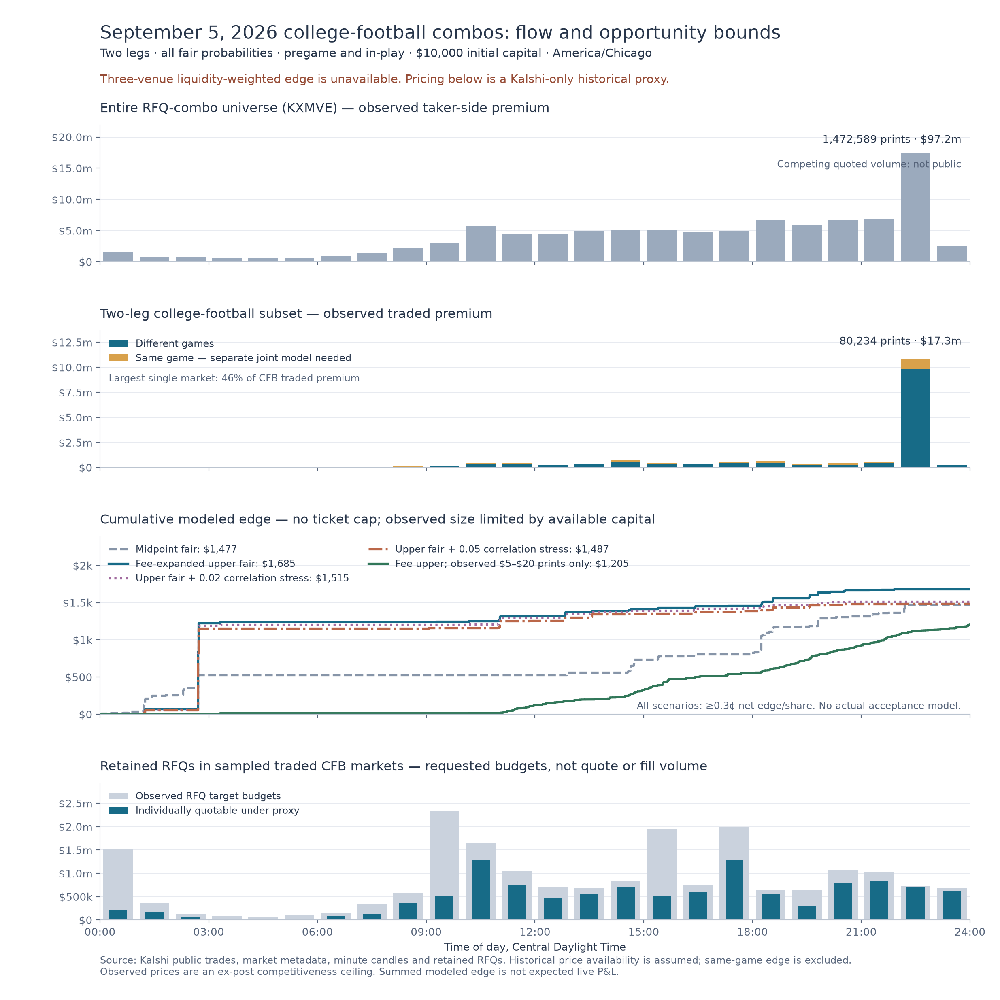
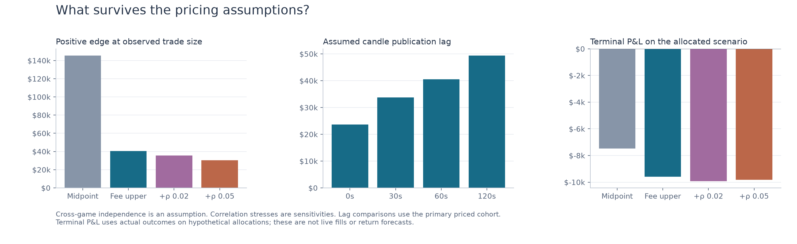

# September 5, 2026: two-leg college-football combo opportunity study

The recovered data support a **completed-print opportunity envelope**, but not yet
the requested Kalshi/Polymarket/Pinnacle liquidity-weighted estimate. Pinnacle
historical odds/capacity and comparable historical liquidity are missing. The
reported pricing numbers are explicitly **Kalshi-only proxies**; the strict
three-venue result is null, not zero.

## Recovered flow

| Measure | Result |
|---|---:|
| Entire RFQ-combo universe, public prints | 1,472,589 |
| Entire RFQ-combo universe, taker-side premium | $97,179,531.11 |
| Traded combo markets with recovered composition | 861,668 / 861,668 |
| Two-leg September 5 CFB prints | 80,234 |
| Two-leg CFB taker-side premium | $17,263,421.22 |
| Cross-game short-YES prints with primary price coverage | 44,971 |
| Those prints with both Polymarket leg-price matches | 33,028 |
| Highest CFB traded-premium hour, CDT | 22:00–23:00 |

Dollar volume is the premium paid on the taker's side, not face-value contract
notional or exchange fee revenue. The whole RFQ-combo series frame uses `KXMVE`.
Flow is highly concentrated: the largest market accounts for
46.4% of CFB traded premium; the five largest
account for 57.5%. Large gross volume
does not establish many independently accessible $10 opportunities.
A separate audit of similarly named non-MVE composites is retained under
`data/derived/nonprefix_composite_audit.json`; it found no traded prepackaged CFB
series omitted from the two-leg scope.

## Opportunity without a ticket cap, starting with $10,000 capital

These scenarios select historically observed YES-taker prints with at least
0.3 cents per share of net modeled edge and allocate at most once per market per
second. There is no customer-spend ticket cap. Each allocation uses the observed
print quantity, reduced only when necessary to fit available cash for principal
plus fees, in 0.01-contract increments. Allocation proceeds chronologically;
there is no hindsight optimization over which later opportunities to fund.
They reserve full principal plus modeled maker fees. All combo fair values are
allowed; no old 2%–5% restriction remains. Same-game combinations are excluded
from the edge calculation until their joint probability is modeled.
Settled cash is released after an assumed 60-second delay and gains can be
reinvested, so reserved exposure can exceed the initial $10,000. There is no
additional per-fixture cap in these capacity scenarios.

| Fair scenario | Allocated print tickets | Modeled edge | Terminal net P&L on hypothetical allocations | Largest single-fixture exposure |
|---|---:|---:|---:|---:|
| Kalshi midpoint product | 365 | $1,477.26 | -$7,484.58 | $3,686.71 |
| Fee-expanded upper product | 196 | $1,685.17 | -$9,592.89 | $5,894.64 |
| Upper product + 0.02 correlation stress | 132 | $1,514.53 | -$9,931.12 | $5,685.01 |
| Upper product + 0.05 correlation stress | 139 | $1,486.52 | -$9,810.69 | $5,685.01 |
| Fee upper, only observed $5–$20 prints | 901 | $1,204.65 | -$995.52 | $7,317.97 |

The reference case concentrates as much as $5,894.64
of gross maximum loss in fixture `26SEP05LCALST`. Two legs per
ticket do not eliminate dependence across tickets sharing the same game.
Positive modeled edge and terminal P&L measure different things; neither is
evidence of actual quote acceptance. The printed prices may not have been
available to this strategy. The scenario also permits partial allocation of a
public print; it is not a simulation of full-size RFQ execution.

The final row separately restricts source prints to $5–$20 of taker premium.
It is a small-trade diagnostic, not a ticket cap on the main scenarios, and does
not prove those trades would have been available to this strategy.
Each scenario selects and funds a different set of tickets. Stricter pricing
can preserve cash for later opportunities, so capital-constrained modeled edge
need not fall monotonically as the pricing reserve increases.

## How much apparent edge survives widening?

At full observed trade size, the sum of positive edge falls from
$145,621.85 using midpoint fair to
$40,518.42 using the fee-expanded
upper fair. The latter is before a capital constraint and is conditional on
completed trades and independence across the two games.

Taker-fee widening creates an uncertainty interval, not a new midpoint. Actual
combo maker fees are subtracted separately. Historical book/price publication
latency is unobserved: the primary convention uses a completed minute candle
at least 60 seconds before the print and allows 120 additional seconds of age.
The lag sensitivity uses the same primary priced cohort; rows lacking an
alternative snapshot remain excluded rather than future-filled.

| Primary midpoint fair band | Priced prints | Taker premium | Signed upper-fair edge across all priced prints |
|---|---:|---:|---:|
| (-0.001, 0.01] | 1,945 | $11,714.87 | -$3,131.88 |
| (0.01, 0.05] | 3,727 | $51,862.52 | -$12,076.59 |
| (0.05, 0.25] | 12,803 | $601,735.76 | -$85,072.47 |
| (0.25, 0.5] | 19,457 | $1,666,091.06 | -$166,967.32 |
| (0.5, 0.75] | 5,868 | $724,063.37 | -$45,359.65 |
| (0.75, 1.0] | 1,171 | $385,043.40 | -$6,067.18 |

## Pregame and in-play attribution

The fee-expanded upper-fair scenario uses one shared capital ledger. These are
contributions from its allocated tickets, not separate independently funded strategies.

| Phase at allocation | Tickets | Modeled edge | Terminal net P&L |
|---|---:|---:|---:|
| pregame | 19 | $1,254.05 | -$9,295.68 |
| in_play | 175 | $430.95 | -$299.82 |
| unknown | 2 | $0.17 | $2.60 |

A ticket is in-play once either matched fixture has started. Unknown schedule
coverage remains explicitly unknown; scheduled start does not identify actual
kickoff delays, game clock, suspensions or reopening latency.

## RFQ and creator evidence

The recovered CFB-market RFQ sample contains 467,041
requests. Among positive target budgets, the median is
$10.00; 260,269
requests are in the $5–$20 range. These are repeated requests, not unique customer
orders or accepted quotes. Hypothetical quoteability is evaluated one request
at a time with a one-second decision delay; it does not reserve capital for all
concurrent quotes or imply that those quotes would be accepted.

Creator identities are **unavailable in this recovered sample**:
535,238 studied-day requests have
blank `creator_id` and 0 have a
usable value. The watchlist/blacklist files explicitly record unavailable
identity, rather than treating an empty blacklist as a clean bill of health.
No creator filter can be applied to these historical quoteability estimates.

The implemented starter policy flags long leg counts and same-fixture
combinations for review when identity is available. Blacklisting requires three
separate observed duplicate-RFQ bursts, each at least 30 requests in 60 seconds
with at least 80% identical leg sets. This is a stated operational research rule,
not a calibrated adverse-selection model. Histories are incomplete and market
sampled. No blacklist is enabled for live execution.

Creator state is designed to be calculated before each request using only earlier
retained identified requests. Public trades also have no creator/RFQ identity, so creator-level adverse
fill markouts and correlation-pickoff attribution are **not established**.
The code supports future labeled observations, and preserves sample sizes and
reasons in `creator_watchlist.json` and `creator_blacklist.json`.

## What remains unavailable

- Historical Pinnacle paired odds, exact line/period mapping and capacity.
- Comparable historical executable liquidity for the three venues. Kalshi
  minute candles have volume/open interest but no historical book depth;
  sampled Polymarket historical-book requests returned no usable depth. Present
  liquidity or full-day final volume must not be used as historical weights.
- The full RFQ opportunity tape, including never-traded markets. The retained
  RFQ population here is conditioned on traded markets and a context sample.
- Competing makers' quoted prices/volume, which are private. The chart therefore
  shows observed trades and clearly labeled sampled RFQ budgets, not fabricated
  all-universe quoted volume.

The three-venue blending function is implemented with strict source, timestamp,
payoff and liquidity checks. Matched Polymarket histories are preserved for
cross-venue price diagnostics; an equal-weight price diagnostic must not be
described as the requested liquidity-weighted blend.

Automated Polymarket matches align teams, period, line and selected outcome for
a normally completed game. Postponement/cancellation rules differ: for example,
Kalshi's 48-hour start window and fair-price resolution do not match Polymarket's
indefinite postponement provision and 50–50 cancellation outcome. These matches
are not yet certified as identical payoffs in every state.

## Implementation audit

The most consequential findings are the old target-cost denominator, fractional
RFQ quantities, occurrence-versus-kickoff semantics, market-specific fee
coefficients, and differences between documented and implemented paper risk
limits. See [the detailed audit](../research/IMPLEMENTATION_AUDIT.md) for evidence,
formulas and source links. The original `../kalshi_mm` project was not changed.

## Coverage and reproducibility

Catalog complete: **True**. Unresolved traded market definitions:
**0**. Their public volume is included in the
whole-universe totals; unresolved composition cannot be assigned to the CFB subset.
Quote exclusions:

| Reason | Prints |
|---|---:|
| same_game_joint_model_missing | 21,045 |
| Priced | 44,971 |
| stale_candle | 7,319 |
| no_taker_not_short_yes | 6,899 |

Raw response envelopes retain retrieval timestamps. `summary.json` records assumptions and coverage. `artifact_manifest.json` hashes the study inputs and outputs. No source data were repaired or replaced by inferred values.
