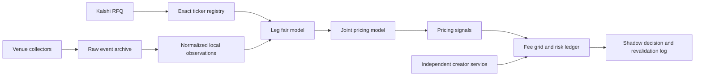

# Non-player NFL pricing infrastructure — September 7, 2026

The launch universe is now 2–4 distinct-fixture, pregame legs from the non-player
families observed in our Pinnacle entitlement: full game, first half and first
quarter moneylines, spreads, totals and team totals. A family being eligible is
not evidence that every line has an equivalent market on all three venues.
Other periods, unobserved exotic families, player props, settled legs and
same-game combinations remain excluded. Every period stops at **game kickoff
minus 60 seconds**, not at the start of its own period.

## Captured coverage

| Family | Exact Kalshi–Polymarket mappings | With Pinnacle selector candidate |
|---|---:|---:|
| Full-game moneyline | 32 | 32 |
| Full-game spread | 83 | 65 |
| Full-game total | 186 | 85 |
| Full-game team total | 9 | 2 |
| First-half outright winner via −0.5 spread | 4 | 4 |
| First-half spread | 16 | 16 |
| First-half total | 22 | 21 |
| First-quarter outright winner via −0.5 spread | 18 | 16 |
| First-quarter spread | 48 | 18 |
| First-quarter total | 36 | 6 |
| **Total** | **454** | **265** |

These count Kalshi contracts, including complementary team listings; they are
not distinct games, independent bets, tradable opportunities or live coverage.
The expansion adds 153 exchange mappings to the 301 full-game mappings in the
same capture. No first-half team-total contracts were listed on Kalshi and no
first-quarter team-total family was listed there. Those families are supported
when exact matching listings appear. The retained Pinnacle snapshot is not a
live freshness test. All mappings retain their payoff-review pricing block.

Inputs and machine-readable exclusions are recorded in
[nfl_nonplayer_mapping_review.json](nfl_nonplayer_mapping_review.json), with
capture hashes. Native integer lines are excluded until a push model exists.
Matching uses exact fixture date, teams, kickoff, period, line and selected
payoff. It never uses the nearest line or an API request in the RFQ handler.

**Settlement finding:** Kalshi first-half/quarter team wins lose on ties;
Polymarket period moneylines split ties 50–50. A Kalshi outright win can instead
match the team's −0.5 spread, when listed. The 32 Kalshi period TIE contracts
require a joint-score/composite-payoff model. Another 42 outright team-winner
contracts lacked an exact Polymarket spread equivalent in this capture.
Source rules are preserved with each successful mapping and in the raw market
captures under `data/raw/nfl_nonplayer_20260907/`.

## Runtime boundaries



`PricingService` takes an observation repository, `LegFairModel`,
`JointPricingModel` and optional `PricingSignal` implementations. Python
Protocols define the boundaries; concrete defaults are `WeightedLegFair` and
`PairwiseMomentJoint`. Constructor injection permits replacing the leg blend,
correlation engine or signal set without changing the RFQ/creator/risk flow.
Signals can block, reduce risk caps and add required edge. Model/signal manifests
enter the engine version and each successful pricing context. Changing models
requires a new pinned run; there is no automatic hot reload or CLI plugin loader.

Defaults preserve the existing fee-expanded liquidity/freshness blend and
venue priors, delayed-Pinnacle guards and pairwise-moment joint bound. All three
venues are required. No ticket cap or probability restriction was added.
Capital remains $10,000; maximum loss is capped at $100 per canonical underlying,
$100 per combo and $250 per fixture, with concentration caps halved in the
existing defensive regime. Risk keys now distinguish periods and team totals.
A period win shares risk with its exact −0.5 spread. Opposing period wins are
not complementary because ties lose on both. Buying/selling and YES/NO flip
orientation; different combo positions receive no unproved hedge credit.

`ShadowEngine` still handles events, quote lifecycle/revalidation and markouts.
Collectors and venue normalization remain separate from pricing. A new data
vendor can implement an adapter to the existing observation schema; adding a
fourth *venue* also requires explicit schema, fee/liquidity policy and validation
changes. The current `Observation` venue set is not dynamically extensible.
Legacy one-off research helpers still coexist with this service. Event-log
replay uses the shadow engine; older standalone opportunity studies must be
migrated before claiming identical research and runtime pricing.

This is a useful composition-based foundation, not a finished trading platform.
Further architectural work should split quote lifecycle from markout evaluation,
automate versioned mapping/schedule/fee refresh outside the RFQ path, and move
standalone studies onto the same pricing interfaces. Keep components small and
explicit rather than building a broad inheritance hierarchy.

## Rebuild and activation

`scripts/configure_nfl_nonplayer.py` compiles complete retained Kalshi pages,
Polymarket events, OddsPapi odds and its market catalog. It validates
`playerProp: false`, periods, outcome pairs and exact selector lines. Selector
candidates do **not** automatically approve settlement or dollar stake limits.

```sh
.venv/bin/python scripts/configure_nfl_nonplayer.py \
  --raw-dir data/raw/nfl_nonplayer_20260907 \
  --base-config config/runtime_nfl_week1_fullgame_snapshot.json \
  --odds runs/oddspapi_smoke_20260907_retry/02_odds-by-tournaments.json.gz \
  --catalog runs/oddspapi_freshness_20260907/football_market_catalog.json \
  --out-config config/runtime_nfl_week1_nonplayer.json \
  --out-review research/nfl_nonplayer_mapping_review.json
```

Refresh public fee metadata with `scripts/refresh_nfl_fee_metadata.py` before
activating the generated configuration. This was done for the present 454
mappings: Kalshi coefficient 0.07, Polymarket 0.05; the functions retain their
venue-specific fee and rounding treatment. Raw evidence is in
`data/raw/nfl_nonplayer_fees_20260907/`. Combo fee/grid validity is independent
and must also be refreshed. The expanded snapshot is now the main
`config/runtime_nfl_week1.json`; the prior full-game config is retained as the
explicit snapshot above. Do not edit source/config in a running pinned run.

## Next work, in order

1. Resolve Pinnacle normal and exceptional settlement (including full-game ties
   and canceled/shortened period markets), native limit currency/stake units,
   and feed verification age. Quiet last-change timestamps do not establish
   stale prices; fresh HTTP responses do not prove a fresh upstream book.
   Implement verified snapshot age separately from last-price-change age,
   retaining the 30-second delay and live-venue disagreement guards. Approve
   exact mappings only after their evidence is attached.
2. Automate discovery/selector refresh and feed health outside the RFQ path.
   Native bookmaker market identifiers can change; currently changed IDs fail
   closed until the registry is rebuilt. Measure subscription/book coverage
   against actual RFQs, including period and team-total markets.
3. Run a sustained three-venue shadow session with the expanded config in a
   new database. Review quote latency, skips, weights, joint reserve, proposed
   edge, risk consumption, creator behavior and restart/replay consistency.
   Public trades alone do not prove hypothetical RFQ acceptance.
4. Complete the execution adapter and account reconciliation/recovery before
   any live run. Submit/accept/revalidate/confirm/cancel, uncertain submissions,
   target-cost quantities and actual fills remain unimplemented or unverified.

The Wednesday shadow target is still reasonable as a development checkpoint;
valid three-venue hypothetical quotes depend on step 1. A recorder-only run can
capture inputs and exclusions sooner. Weekend live readiness is not established.
