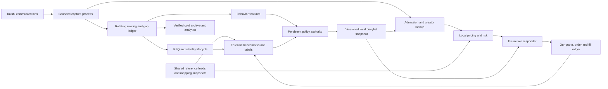

# Forward RFQ collection and creator denylist

Design date: September 7, 2026. Status: proposed architecture, supported by code review and a read-only audit of retained live data. No production policy or trading code changed.

Implementation follow-up: the user narrowed the first delivery to offline behavioral screening without fill or pricing requirements. The implemented collector, repeated/minor-edit parlay rules, persistent blacklist and operating commands are in [RFQ_SNIFFER.md](RFQ_SNIFFER.md). The economic-model and live-enforcement sections below remain future architecture, not requirements for that sniffer.

Build a persistent **creator-ID denylist with a local lookup before pricing and before quote submission**. Continue collecting ignored IDs. Maintain separate reasons for resource abuse, adverse selection and unsupported correlation structures; a single blacklist bit should be an execution output, not the entire evidence model. “Non-cust” here means spammy or toxic behavior, not an exchange account classification.

The first delivery should collect continuously and support automatic, expiring spam cooldowns plus explicit durable blocks. Economic blacklisting should follow independent benchmark and execution evidence. The existing NFL/MLB model research supplies versioned pricing inputs; this service owns capture, evidence and enforcement.

## What we already have

| Existing component | Reuse | Required extension |
|---|---|---|
| `src/combos/live_collectors.py` | Authenticated communications, public trades, lifecycle and bounded book subscriptions; batch persistence | Separate capture from enrichment/pricing; explicit queue/byte budgets, session metadata on every envelope, comprehensive lifecycle projection |
| `src/combos/event_store.py` | Compressed immutable records, FULL SQLite WAL, deduplication keys, atomic outputs/checkpoints | Dedicated flow storage, rotating archival, event/receipt/availability/commit times and disk pressure handling |
| `src/combos/shadow.py`, `journal.py` | Communications-only capture, sequence diagnostics, rotating checksummed chunks | Harden crash recovery and use the newer runtime clock behavior; closed journal chunks currently require clean manifests for replay |
| `src/combos/creator_service.py` | Persistent RFQ-ID deduplication; rolling identical-leg bursts; `clear/watch/cooldown/blocked`; overrides and causal history | Multiple behavioral features, scoped policies, label ingestion, separate publication time, persistent snapshots across capture rotations |
| `src/combos/creator_profile.py`, `creators.py` | Offline request profiling and transparent reasons | Consolidate policy interpretation around one versioned evidence contract |
| `src/combos/shadow_engine.py` | Local policy check, creator watermark barrier, pregame/scope guards, hypothetical quote markouts | Independent observation-only labels for rejected RFQs, full lifecycle capture, live enforcement adapter |
| `src/combos/pricing_service.py` | Exact mapping registry; replaceable leg/joint models and pricing signals | Versioned forensic model adapter for supported correlation structures; creator gate belongs before this service |
| `src/combos/payoff_risk.py`, `risk.py` | Canonical payoff exposure and atomic reservations | Preserve live commitments until exchange lifecycle reconciliation; link policy cancellations to actual acknowledgements |

The current duplicate rule is at least 30 requests in 60 seconds with at least 80% sharing the current leg set. Three separated bursts trigger a one-hour cooldown. It is an operational heuristic, not a calibrated toxicity estimate. Counts since the previous cooldown have no separate recency decay, so widely separated bursts can accumulate; add an explicit evidence window.

The runtime already checks Kalshi subscription sequences through `Books.consume`, including non-book messages. Preserve that coverage when splitting processes. The current collector stores parsed messages rather than exact wire bytes and performs JSON parsing, compression/database writes and book normalization in its receive loop. All consumers contend for the same SQLite writer, and the shadow consumer waits for the creator consumer. These are the key overload coupling points.

The present markouts are explicitly hypothetical and benchmarked against the same pricing model. They are scheduled only after much of pricing succeeds, before the final risk-allowed check. Creator markout grouping retains only the first `(creator, fixture-set, horizon)` row; keep every original label and create aggregation separately, including model version and date. `PricingService` currently rejects same-fixture combinations before calling its joint-model plugin. Supporting forensic same-game evaluation therefore needs a separate reviewed path; swapping a joint plugin alone will not do it.

## Evidence from the retained capture

A complete read-only scan of `runs/shadow_research_20260907/capture_002/events.sqlite` found:

| Metric | Observed |
|---|---:|
| Unique RFQs | 85,147 |
| Receipt span | 99.715 seconds |
| RFQ rate over that span | 853.9/second |
| Maximum in one UTC-aligned second | 1,315 |
| Distinct creators | 8,984 |
| Missing creator IDs / repeated create IDs | 0 / 0 |
| Largest creator request count | 4,225 |
| Maximum legs in a request | 110 |
| Creates with a delete in the same capture | 58,912 |
| Deletes with no create in the same capture | 24,855 |
| Private quote lifecycle messages | 0 |

The high request count and deletion counts are not findings of malicious behavior. Boundary effects alone make a naive deletion-to-creation ratio misleading. The capture's [readiness report](../runs/shadow_research_20260907/capture_002/readiness.json) records zero submitted orders and zero active three-source pricing intersections. The [throughput review](RUNTIME_THROUGHPUT.md) reports 0.210-second p99 receive-to-decision latency for a predominantly rejected workload; it does not benchmark healthy pricing under attack.

Reproducible evidence: [audit result](rfq_flow_design/capture_002_audit.json), [read-only audit script](rfq_flow_design/audit_capture.py), and [reviewed source hashes](rfq_flow_design/reviewed_source_hashes.json). The result records the input high-water sequence and a digest of scanned Kalshi payloads. Earlier historical RFQs had blank IDs, whereas the larger forward recording reported 1.46 million RFQs with IDs. See [historical audit](IMPLEMENTATION_AUDIT.md) and [runtime review](NFL_RUNTIME_REVIEW.md).

## Exchange facts that determine the design

1. **Capture from WebSocket communications.** RFQ creates/deletes are broadcast; quote events are restricted to the involved participants. Market filtering is ignored on this channel. Optional `shard_factor`/`shard_key` partitions exist for fanout management. Full capture requires every partition; record the partition assignment and do not confuse it with an exchange matching-engine index. The documentation's create example has an empty ID, so identity availability must remain a measured capability despite our complete local sample. [Communications](https://docs.kalshi.com/websockets/communications).
2. **Do not depend on REST for a historical census.** RFQ listing provides cursors and pages up to 100, with market/event/status/user filters. Reconciliation can discover later state, but cannot reconstruct original receipt times or guarantee every missed request. [Get RFQs](https://docs.kalshi.com/api-reference/communications/get-rfqs).
3. **Use the public communications identifier.** The retained OpenAPI identifies `creator_id` as public, `creator_user_id` as private, and creator subaccount visibility as restricted. Preserve missing identity as unknown, never as a shared empty-string identity. Late identity discovery creates an as-of binding, not a rewrite of a past decision. [RFQ schema](https://docs.kalshi.com/api-reference/communications/get-rfq); local schema at `data/raw/kalshi_openapi.yaml:7203`.
4. **Acceptance, confirmation, order entry and fill are different states.** Combos use a three-second confirmation window and one-second execution timer. Confirmation is the commitment boundary after which neither party can withdraw. Quotes cover the full RFQ size, and target spend implies a price-dependent quantity. A risky RFQ cannot simply be quoted at a smaller size. [RFQ lifecycle](https://docs.kalshi.com/getting_started/rfqs).
5. **Reconcile by identifiers.** Retain RFQ ID, quote ID, quote version, our client/order IDs and requester order ID where visible. Use the RFQ-scoped quote endpoint; quote-created/accepted/executed notifications alone do not establish filled quantity. [Get RFQ Quote](https://docs.kalshi.com/api-reference/communications/get-rfq-quote), [Get Fills](https://docs.kalshi.com/api-reference/portfolio/get-fills).
6. **Budget all HTTP users together.** Rate limiting uses token buckets, not simply requests/second. The quote-create endpoint documents a two-token cost; default endpoint cost is ten unless specified otherwise. Read account limits and endpoint costs at startup; keep reserved capacity for lifecycle and reconciliation. Handle 429s with bounded backoff and jitter rather than per-RFQ retry storms. [Rate limits](https://docs.kalshi.com/getting_started/rate_limits), [quote creation](https://docs.kalshi.com/api-reference/communications/create-quote), [endpoint costs](https://docs.kalshi.com/api-reference/account/list-non-default-endpoint-costs).
7. **Preserve current financial metadata.** Store decimal dollar prices, quantities, price ranges, fees and effective dates. September 3 introduced finer edge ticks for combos. Use authoritative `exchange_index` metadata for routing. The retrieved changelog also includes September 10 entries, which are future-dated relative to this design; they are not assumed deployed. [Changelog](https://docs.kalshi.com/changelog), [exchange sharding](https://docs.kalshi.com/getting_started/exchange_sharding).

Creator identity stability across reconnects, days, broker aggregation and any ID rotation is not established by one capture. Measure it and retain the exact identifier namespace. Do not merge IDs merely because they submit similar requests.

## Proposed service structure



Use one supervised, always-on host initially, with separate processes and storage budgets for capture, reference data, features/policy, and research analytics. Keep SQLite for a single-writer policy/control database and bounded materialized RFQ state. Store the high-volume raw stream in rotating append-only segments and analytical tables in partitioned Parquet. DuckDB or equivalent offline SQL can read those partitions; introduce a distributed stream or analytical database only when measured load or multiple hosts require it.

Capture and policy state must live outside experiment-specific `runs/.../events.sqlite`. Proposed deployment layout:

```text
rfq_flow/
  control/policy.sqlite
  control/identity.sqlite
  snapshots/denylist.current.json
  spool/<collector>/<session>/<segment>
  archive/date=YYYY-MM-DD/hour=HH/<segment>
  normalized/<table>/date=YYYY-MM-DD/<partition>
  manifests/<capture-or-build-id>.json
```

This is a deployment layout, not a directory created by this design. Capture rotations must never reset blocks or rolling creator history. The live responder uses an in-process map loaded atomically from snapshots, with a last-known-good snapshot on disk. Avoid a database or network request for each RFQ. A separate signal refresh updates the map, while every decision records exactly which policy version it used.

## Data contracts

| Table or stream | Key and essential fields |
|---|---|
| `raw_events` | Collector/session/local offset; channel, subscription ID, upstream sequence when present, partition assignment; exchange event time, wall receipt time, monotonic receipt time, persisted time; raw bytes/digest, schema version, parse outcome |
| `capture_intervals` | Session and interval; connected/acknowledged status, missing sequence range, disconnect, clock jump, dropped frames/bytes if measurable, unknown loss flag, archive status |
| `rfq_events` / `rfq_state` | RFQ ID; observed creates/deletes/REST state; market, creator binding, size mode, original decimal size, collection, raw-leg reference, first/last observed time; terminal reason only when supplied |
| `identity_bindings` | RFQ ID, exact creator ID/namespace, source event, first available time, confidence=`exchange_observed`; unknown/late-bound/conflicting states |
| `combo_definitions` / `rfq_legs` | Definition version; ordered original legs plus canonical payoff hash; fixture/milestone, sport, period, team/player, market family, strike, selected side, settlement scalar, mapping/rule version |
| `reference_snapshots` | Source observation IDs, provider event/publish/receipt/eligible times, freshness/health, price/depth/capacity, mapping and fee versions; reuse existing observations by reference |
| `rfq_evaluations` | RFQ ID and evaluation time; admission reason, resource budget, creator snapshot ID, structure flags, model/feature versions, benchmark IDs, hypothetical quote side/price/quantity, uncertainty and eligibility |
| `our_quote_events` / `our_fill_events` | All commands and responses, quote replacements, accept/confirm/delete attempts and acknowledgements, deadlines, order/client IDs, actual side/quantity/price/fees, partial fills and reconciliation status |
| `labels` | RFQ/decision/fill ID, label type, horizon, anchor time, benchmark version, due/available/computed times, observed/censored/unavailable status, signed move, gross/net economics, confidence and reasons |
| `creator_features` | Creator plus window/as-of version; raw counts, independent evidence count, behavior metrics, economic evidence, missingness, gap coverage, source offsets |
| `policy_events` | Creator, scope, previous/new action, reason codes, evidence references/window, policy version, effective/publication/expiry times, override provenance, superseded event |

Exactly duplicate wire events remain auditable; logical request counts deduplicate by RFQ ID. Conflicting payloads go to an anomaly record. Repeated leg sets with different RFQ IDs remain distinct requests for load measurement. Canonical signatures collapse leg order and reviewed payoff aliases but retain side, period, threshold, rules and scalar settlement semantics. Maintain a separate approximate similarity signature for near-duplicate analysis; it cannot establish identity equivalence.

Every expensive evaluation uses a recorded selection rule. Capture cheap features for all traffic, price supported candidates, and use a deterministic hash sample of rejected/blocked candidates for forensic evaluation with recorded inclusion probabilities. This preserves visibility into excluded flow without making the collector evaluate 110-leg requests. Unknown or unsupported structure remains a feature with missing economic labels.

## Resource-abuse controls

This is application-level resource exhaustion through exchange-distributed messages. A creator filter cannot prevent Kalshi from transmitting those frames, and RFQs do not expose a requester IP to firewall. The protection is to bound our downstream cost and preserve capacity for commitments. AWS's guidance supports throttling by both volume and complexity and setting explicit concurrency limits. [Throttle requests](https://docs.aws.amazon.com/wellarchitected/latest/reliability-pillar/rel_mitigate_interaction_failure_throttle_requests.html).

Admission order:

1. Enforce frame-byte, nesting and parser bounds; record malformed/oversized traffic and explicit loss if the socket must be reset.
2. Extract RFQ ID, creator ID, size and cheap structure. Reject duplicate event work; retain logical counts for genuine new RFQs.
3. Check active creator/scope denylist, request age and supported pricing scope.
4. Claim global, per-creator and per-template computational tokens. Set a finite global in-flight limit and queue deadline. Anonymous traffic gets its own bounded share; it cannot bypass limits through new identities.
5. Resolve metadata from bounded caches. Coalesce identical in-flight lookups, use negative-cache expiry, and send cache misses to a separately budgeted queue. Never fetch leg metadata or bookmaker odds synchronously for every RFQ.
6. Price within a bounded worker pool. Cache key includes canonical combo, quote side, reference snapshot IDs and model version; a reference move invalidates reuse. Stop expired work before solving.

Track 1-second, 10-second, 60-second, 15-minute and daily windows: requests, bytes, leg counts, estimated/actual CPU, identical and near-identical reissues, inter-arrival times, create/delete lifetimes, simultaneous observed open requests, cache misses, subscription churn and legitimate quote outcomes where observed. Normalize against time of day, active events, price moves and platform-wide load. User edits, replacements and stale quotes are plausible benign causes of retries.

Treat three distinct situations differently:

| Evidence | Response |
|---|---|
| Capacity exceeded now | Immediate token denial/defer with short deadline; no claim about intent |
| Repeated disproportionate cost or repetitive bursts | Expiring creator cooldown with evidence; keep the present 30/60s/80% rule as one initial shadow feature |
| Sustained, reviewed abuse across windows | Persistent creator-wide `blocked` entry; explicit reason and review date |

A candidate starting cooldown schedule is 5 minutes, 30 minutes and 6 hours for repeated qualifying breaches within 24 hours, resetting escalation after a clean period. These are proposed settings for replay validation, not empirically selected thresholds. Never wait for three 60-second bursts before protecting a saturated worker pool.

Fair scheduling should reserve capacity for creators outside the dominant burst, for new IDs and for a small blocked-flow research sample. Global limits remain authoritative against many-ID floods. Similarity clusters can throttle a hot template but must not automatically blacklist every creator using it. Do not label high-volume metrics or long legs alone as proof of attack.

Private accept/confirm/order/fill processing needs reserved CPU, queue and API capacity. A second communications connection still receives public RFQs under documented behavior; do not assume a private-only filtered channel. At ingestion, route relevant own-quote events to reserved capacity, and validate any proposed FIX/private-path alternative before relying on it.

## Correlation and economic evidence

**Structural protection applies regardless of creator.** Classify combinations by canonical fixture, not ticker event alone: same-game outcomes, overlapping periods, team totals versus game totals, nested spreads, player/team relationships, duplicated or opposing payoffs, and exceptional settlements. Shared fixtures across different tickets also consume aggregate risk capacity. The present 2–4-leg cross-fixture pregame launch guard remains the executable scope until a reviewed model covers more.

For supported combinations preserve three distinct estimates: marginal product, an independently specified joint benchmark, and a conservative dependence bound. The current `pairwise_moment_upper_v1` rho ceiling is explicitly uncalibrated; it is a risk assumption, not evidence that a creator found an actual correlation error. Marginal bookmaker odds do not identify a same-game joint probability. If no defensible joint benchmark exists, label `correlation_unresolved` and decline/restrict the structure.

Let `p0` be YES fair at a decision or fill, `p_h` its benchmark at horizon h, `q` the actual contracts, and `d=+1` for maker long YES-equivalent exposure or `d=-1` for short YES-equivalent exposure. Then:

```text
maker adverse drift per contract = -d * (p_h - p0)
maker mark-to-benchmark P&L       = q * d * (p_h - execution_yes_equivalent_price) - actual_fees
```

For the current sell-YES/buy-NO strategy, rising YES fair is adverse. Buying NO at `b` corresponds to a YES-equivalent sale at `1-b`. Normalize signs from actual execution data and contract payoff; do not infer requester direction from requested leg sides. Before acceptance, an RFQ does not prove which quote side the requester will take. Record both conditional directions or an explicitly hypothetical maker-side evaluation. Public prints must never be joined to creator IDs by ticker/time proximity.

Separate labels:

| Label | What it supports |
|---|---|
| `request_structure` | Correlation exposure, unsupported payoffs, repeated probing of structures |
| `request_benchmark_move` | Subsequent movement conditional on the observed request; no assumed acceptance |
| `hypothetical_quote_markout` | Replay economics for a specified quote, explicitly no fill claim |
| `own_quote_acceptance` | Selection against an actual quote and quote version |
| `own_execution_markout` | Strategy economics from verified fills; requester attribution requires a supported link |
| `settlement_pnl` | Final economics using the actual payoff, including non-binary/scalar settlement if applicable |

Use request, quote, accept, confirm and fill anchors separately. Proposed horizons are 1, 5, 30 and 120 seconds, plus pregame closing reference and settlement. Short-horizon labels require sufficiently fresh observable benchmarks: a delayed Pinnacle input cannot establish a one-second pickoff. Record the first valid eligible observation within a specified grace window and its exact horizon error; missing, stale, suspended or gap-crossing intervals remain unavailable/censored rather than zero movement.

**Static correlation mispricing need not create a short-horizon markout.** For a YES seller, compare candidate sale price against an independent joint benchmark, fees and uncertainty at the same timestamp. Store `p_joint - product(p_leg)` and sensitivity under alternative valid dependence models. Keep model version fixed when decomposing a price move into changed marginals versus changed dependence assumptions. Retraining-induced changes are a separate diagnostic. Settlement calibration across fixtures is needed to test persistent joint-model error.

Creator-level toxicity is the recurring economic loss attributable to that flow after accounting for structure, sport, side, time to start, reference staleness, quote aggressiveness and common market moves. Compare against matched contemporary requests/fills and use hierarchical shrinkage toward the relevant cohort. If every creator exploiting one structure looks bad, block/reprice the structure first. A successful trader can still be profitable to quote with adequate margin.

Empirical market-making research shows that fill probability and post-fill returns can trade off; counting RFQs or optimizing hit rate alone is insufficient. Its numerical results are from crypto, not a calibrated Kalshi rule. [Albers et al., The Market Maker's Dilemma](https://arxiv.org/abs/2502.18625).

Keep every label, but estimate uncertainty by independent fixture/day clusters, allowing overlapping fixture sets to share a cluster. Thousands of reissues or six horizons on one game are not thousands of independent outcomes. Report both dollars and per-contract loss, stake concentration and sensitivity to large trades. Use walk-forward training, validation and later untouched evaluation; label availability must precede policy publication.

A conservative **candidate** for economic restriction is at least 30 independent fixture clusters across at least five trading dates, positive out-of-sample lower confidence bound on net adverse economics, and corroboration beyond the quote model itself. The confidence level, loss tolerance and evidence minimum require calibration, multiplicity control and temporal validation. Sparse creators remain unknown or watched; a strong population-level structure guard can act before creator-specific evidence is adequate. A request-only signal can support provisional caution, but cannot establish execution-conditioned profitability.

## Persistent policy and live behavior

Use the existing names `clear`, `watch`, `cooldown`, and `blocked`, adding scope and evidence dimensions. `cooldown` and `blocked` compile to a denylist entry. `watch` may impose a stricter capacity allocation or additional edge when supported, but does not silently mean blocked.

| Dimension | Scope and default action |
|---|---|
| Resource abuse | Creator-wide skip of new pricing/quotes for a bounded cooldown |
| Economic toxicity | Initially creator × sport × structure family × maker direction; no-quote or extra required edge |
| Structural/model deficiency | Structure-wide skip for all creators until model/rule review |
| Explicit override | Durable creator-wide or scoped block/clear with reason, evidence and review date |

Globalize an economic block only with evidence across scopes or an explicit override. Do not clip the RFQ's size: lower risk capacity means skip if the full request cannot fit. Extra required edge must be translated into a valid full-size quote and rechecked for target-cost sizing and fees.

Example proposed snapshot entry (illustrative, not an active blacklist):

```json
{
  "schema_version": 1,
  "policy_version": "flow-policy-v1",
  "snapshot_version": 184,
  "creator_id": "example_creator",
  "status": "cooldown",
  "scope": {"sport": "*", "structure": "*", "maker_direction": "*"},
  "actions": ["skip_new_pricing", "skip_new_quotes"],
  "reason_codes": ["repeated_resource_budget_breach"],
  "evidence_refs": ["creator-window:example:123"],
  "effective_at": "2026-09-07T23:00:00Z",
  "expires_at": "2026-09-07T23:30:00Z"
}
```

Publish with temporary-file write, flush/fsync and atomic rename, recording a content hash, monotonic snapshot version, publication timestamp and source watermarks. Invalid snapshots never replace the last good version. Each responder acknowledges the installed version; monitor propagation lag. A late record can inform the next policy version but cannot retroactively change which IDs were ignored.

Live checks occur at receive/admission, immediately before quote submission and before confirmation. Cache a request's lifecycle generation so a deletion or newer quote version invalidates queued work. A new block suppresses new offers and initiates best-effort withdrawal of unconfirmed offers. Confirmation races require explicit state transitions: after confirmation, retain obligations and risk until fill/cancel/reconciliation evidence resolves them. Never delete an accepted/confirmed event or release capital solely because an ID became blocked.

`quote_executed` starts an order/fill reconciliation, not an assumed full fill. Even a fill on our resulting order may involve another resting participant; classify creator attribution separately and retain `counterparty_unverified` when identifiers do not establish the requested bilateral link. Later resting-remainder fills should not automatically become requester toxicity labels.

At restart, load the durable last-good policy and reconstruct live obligations before accepting new quoting work. If policy service is stale, continue capture, retain explicit blocks and suppress new quotes after a configured freshness deadline; do not clear all entries because the lookup service failed. Expiring entries follow their recorded expiry rules. Missing creator IDs get a recorded no-quote disposition initially, matching current shadow behavior. Allowlist overrides cannot bypass global resource, mapping or financial risk limits.

## Collection coverage, retention and operations

Capture all communications envelopes at measured sustainable volume, including blocked and unsupported RFQs. Separate `pricing_skipped`, `forensic_not_sampled` and `capture_missing`; these mean different things. Log health from an independent supervisor so a stopped capture process cannot look healthy through its own missing heartbeat.

On a disconnect, mark the affected interval; rejoin and wait for subscription acknowledgements. Preserve upstream sequences by session/subscription without inventing a cross-session sequence. Reconcile a bounded set of known open RFQs and our quotes/orders/fills. Do not call a 404 proof of a specific cancellation reason. Restored records retain recovery receipt time and cannot repair the historical claim that they were available earlier. Pending lifetimes at capture boundaries are left/right censored.

Use separate disk space and bounded spool capacity so archived research cannot starve live capture. Degrade expensive enrichment and analytical copies first. If raw persistence itself cannot keep up, emit a measurable loss/gap record using reserved telemetry capacity and stop new quoting; there is no unconditional lossless promise under unlimited traffic. Archive sealed segments with checksums, validate upload and manifest continuity, then expire local segments under a configured retention policy.

Initial retention proposal: 24–48 hours of local spool subject to disk capacity, 30 days of full compressed raw data in cold storage, 180 days of normalized request/features, and longer-lived policy evidence plus pinned supporting raw segments. Reference snapshot retention must cover every retained economic label's provenance. The earlier runtime estimated about 52 GB/day compressed and 186 GB/day SQLite from short samples: 30 days of raw at the former rate is about 1.56 TB before overhead. These are planning estimates, to be replaced by measured bytes per message and daily seasonality. See [runtime storage findings](NFL_RUNTIME_REVIEW.md).

Dashboard and daily report: capture coverage by session/partition, creator-ID coverage, rate/bytes/legs, queue age, writer stalls, disk/archive lag, reference health, ignored RFQs by reason and scope, active blocks and expiries, policy propagation delay, exceptions/overrides, retained-label coverage, independent sample sizes, and verified economics. Keep creator IDs out of unbounded metrics labels; use bounded top-K diagnostics and queryable evidence tables.

Report prevented computation using observed costs and candidate workloads. Report avoided trading loss only on a defensible evaluated cohort; after a block, actual acceptance outcomes are unobserved. Continue a probability-recorded shadow sample of blocked flow. Any later live exploration is a separate bounded trading experiment, not a prerequisite for passive collection or an assumed fill model.

## Delivery sequence and acceptance criteria

1. **Capture and contracts.** Add `flow_capture.py`, `flow_schema.py`, `flow_lifecycle.py` and a dedicated supervisor/CLI; reuse authentication, clocks and archives. Emit identity coverage and gap reports. Establish metadata/cache budgets and always-on storage. Preserve a frozen code/config/schema manifest. This phase can proceed independently of NFL/MLB backtests.
2. **Persistent policy authority.** Add `flow_features.py`, `flow_policy.py` and atomic denylist snapshots. Import existing creator evidence as explicitly historical evidence with a new import availability time; do not activate old research flags automatically. Expose `block`, `unblock`, `watch`, `list`, `explain` and `replay-policy`. Run candidate spam thresholds in shadow alongside the current policy.
3. **Live adapter boundary.** Add an admission-policy interface around the eventual responder, with the lifecycle behavior above. The current repository has no live submission adapter, so implementing a denylist file alone is not end-to-end enforcement. A separate existing live bot, if used, must implement and verify this same boundary.
4. **Forensic labels and economic policy.** Add `flow_benchmarks.py`, `flow_labels.py`, and walk-forward reports. Consume versioned outputs from the model team; preserve unsupported structures. Review candidates with supporting RFQs, benchmark snapshots, independent fixture counts and profitability at alternative margins. Promote calibrated scoped economic restrictions only after validation.

Suggested interface, not yet implemented:

```python
admit(request, policy_snapshot, resource_state, now) -> AdmissionDecision
evaluate_structure(canonical_legs, model_manifest, references) -> StructureEvidence
label(observed_event, anchor, benchmark_snapshot) -> Label
compile_policy(feature_snapshot, mature_labels, overrides) -> PolicySnapshot
explain(creator_id, scope, as_of) -> EvidenceBundle
```

Required verification before calling this production-ready:

- Replay retained traffic with duplicate wire events, missing IDs, late identity, out-of-order delete/accept events, reconnects and shuffled duplicate copies. Logical counts and as-of decisions must remain correct.
- Kill capture/writer/policy processes mid-batch and mid-publication. Recover closed segments/checkpoints, reject corrupt snapshots and preserve active blocks and live obligations.
- Replay at five times the observed 1-second peak (about 6,575 RFQs/second), with proportionally stressed message bytes and long-leg/cache-miss workloads. Also benchmark healthy 2–4-leg pricing and a many-ID unique-template flood. Report sustainable rates and overload dispositions; this is a test target, not a claimed capacity.
- Require bounded memory/queues, no unaccounted loss inside the supported capacity envelope, and visible gap alarms beyond it. Protect the own-quote lifecycle even when enrichment fails. Suggested admission-plus-policy p99 target is under 5 ms, separate from overall response latency; measure on the chosen host.
- Verify quote/confirm races, restart restoration, target-cost full sizing, partial fills, scalar settlement, fees, and maker-direction signs. Policy propagation should be tested to a chosen deadline, initially 100 ms locally, with no remote lookup on the pricing path.
- Run an uninterrupted 24-hour capture first, then a full NFL game week for seasonal calibration; NFL evidence must span independent game slates, not merely many RFQs in one evening. MLB daily slates can supply more frequent validation. Sparse economic evidence remains explicitly insufficient.
- Compare proposed policy with no creator filtering and the existing cooldown baseline on later data. Track computation saved, retained supported demand, overridden blocks and net verified economics. Do not estimate counterfactual fills for ignored traffic from public prints.

The concrete first milestone is a continuous recorder plus persistent, explainable creator blocks and expiring spam cooldowns, with a tested live lookup boundary. Correlation-risk guards operate for every creator; calibrated toxicity evidence adds selective restrictions as forward data matures.
